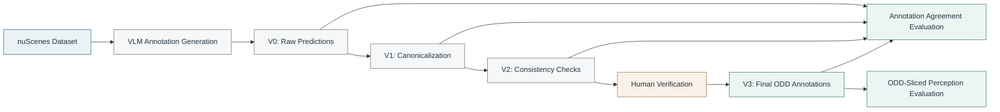

# nuScenes-ODD

**Quality-controlled Operational Design Domain (ODD) annotations for nuScenes.**

Research code for the IEEE IV 2027 submission. 
## Pipeline

The nuScenes-ODD pipeline combines vision-language model (VLM) annotation generation, automated quality control, and human verification to produce structured Operational Design Domain (ODD) annotations. The resulting annotations support dataset analysis and condition-aware perception evaluation.



### Main Components

1. **VLM Annotation Generation:** Generate ODD descriptions from nuScenes camera images using GPT-4o.
2. **Canonicalization (V0 → V1):** Standardize attribute names, categorical values, and annotation formats.
3. **Consistency Checks (V1 → V2):** Apply temporal continuity and cross-attribute semantic rules to correct inconsistencies and flag uncertain annotations.
4. **Human Verification (V2 → V3):** Review and validate annotations to produce the final quality-controlled ODD dataset.
5. **Annotation Agreement Evaluation:** Measure agreement between annotation stages and manually verified reference labels.
6. **ODD-Sliced Perception Evaluation:** Evaluate object detection performance across ODD-defined conditions using the final annotations.

## What's included

| Folder | Purpose |
| --- | --- |
| [`prompts/`](prompts/) | Structured VLM prompt |
| [`scripts/data_extraction/`](scripts/data_extraction/) and [`scripts/batch/`](scripts/batch/) | Prepare three-camera requests; submit and collect VLM batches |
| [`scripts/processing/`](scripts/processing/) | Normalize labels and check temporal/semantic consistency |
| [`ui/`](ui/) | Human-review applications |
| [`scripts/evaluation/`](scripts/evaluation/) | Evaluate V0–V3 agreement, traffic signs, and ODD-conditioned detection |
| [`configs/`](configs/) | Attribute mappings, slice configuration templates, and paper reference values |
| [`docs/`](docs/) | Attribute list, annotation guide, and experimental reproduction instructions |

## Install and check

Python **3.11** is supported.

```bash
python -m pip install -r requirements.txt
python -m unittest discover -s tests -v
```

The offline checks do not require a nuScenes download, API key, or GPU.

## Annotation pipeline

1. Download [nuScenes v1.0-trainval](https://www.nuscenes.org/) locally.
2. Generate requests for the front-left, front, and front-right cameras:

   ```bash
   python scripts/data_extraction/make_requests_jsonl.py \
     --dataroot /path/to/nuscenes \
     --prompt-path prompts/gpt4o_odd_prompt.txt \
     --out run_outputs/requests.jsonl
   ```

3. Submit and retrieve requests using [`scripts/batch/README.md`](scripts/batch/README.md). Submission requires an `OPENAI_API_KEY` and incurs API usage.
4. Run `scripts/processing/preprocess_normalize.py`, followed by `scripts/processing/semantic_scene_consistency.py`, on the exported annotation CSV.
5. Inspect raw and flagged records with [`ui/review_raw/`](ui/review_raw/README.md) and [`ui/review_flags/`](ui/review_flags/README.md).

The 21 evaluation attributes are listed in [`docs/ODD_ATTRIBUTES.md`](docs/ODD_ATTRIBUTES.md), and the human-review protocol is in [`docs/ANNOTATION_PROTOCOL.md`](docs/ANNOTATION_PROTOCOL.md) and [`docs/annotation_guidelines.pdf`](docs/annotation_guidelines.pdf).

## Paper evaluations

| Experiment | Script |
| --- | --- |
| V0–V3 annotation agreement | `scripts/evaluation/evaluate_annotation_stages.py` |
| Traffic-sign classification and text similarity | `scripts/evaluation/evaluate_traffic_signs.py` |
| ODD-defined nuScenes validation subsets | `scripts/evaluation/build_odd_slices.py` |
| BEVFusion and BEVFormer-Tiny mAP/NDS by condition | `scripts/evaluation/evaluate_detection_slices.py` |

The complete commands and input formats are in [`docs/REPRODUCE_RESULTS.md`](docs/REPRODUCE_RESULTS.md). [`configs/manuscript_targets.json`](configs/manuscript_targets.json) contains the **reported paper values** (including stage F1, traffic signs, and ODD-sliced detection results), for comparison with independently computed outputs.

nuScenes images, original annotation exports, full detector predictions, and third-party model checkpoints are distributed separately; they are not included in this code package. Evaluation tools accept these as inputs and never derive experimental measurements from the paper reference values.

## License

[MIT](LICENSE.txt).
